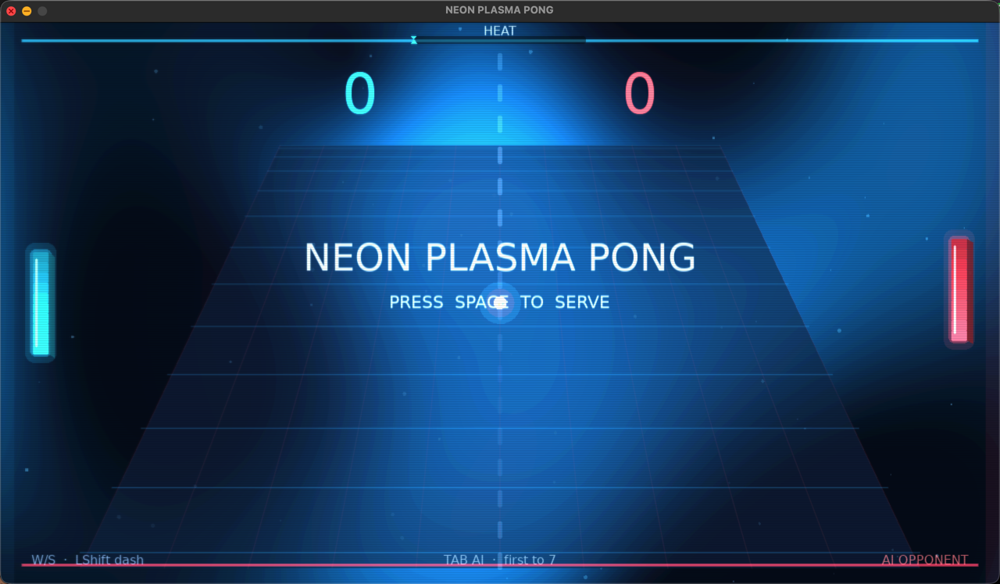

# Pong (Love2D)

**Name:** [Your Full Name]  
**Class / Section:** [Your Class / Section]

## Description

A classic two-player Pong game built with [LÖVE](https://love2d.org/) 11.5 and Lua. Each player controls a paddle, the ball bounces off walls and paddles using AABB collision, and the first player to score more points wins the rally. Movement uses delta time (`dt`) so speed stays consistent across machines.

## How to run

1. Install [LÖVE](https://love2d.org/) for macOS (or use the official `.app` in Applications).
2. Open a terminal in this project folder.
3. Run:

```bash
love .
```

## Controls

| Action | Player 1 (left) | Player 2 (right) |
| --- | --- | --- |
| Move up | `W` | `Up` arrow |
| Move down | `S` | `Down` arrow |
| Serve the ball | `Space` | `Space` |
| Quit | `Escape` | `Escape` |

## Own changes

1. **Different paddle colors** — left paddle is cyan, right paddle is coral.
2. **Space to serve** — the ball waits in the center until you press Space.
3. **Ball speed-up** — after each paddle hit, the ball gets about 5% faster.

## Screenshot



*(Add a screenshot of the running game to `screenshots/pong.png`.)*

## Demo video

[Watch the short demo](demo/pong-demo.mp4)

*(Add a short demo video to `demo/pong-demo.mp4`.)*
